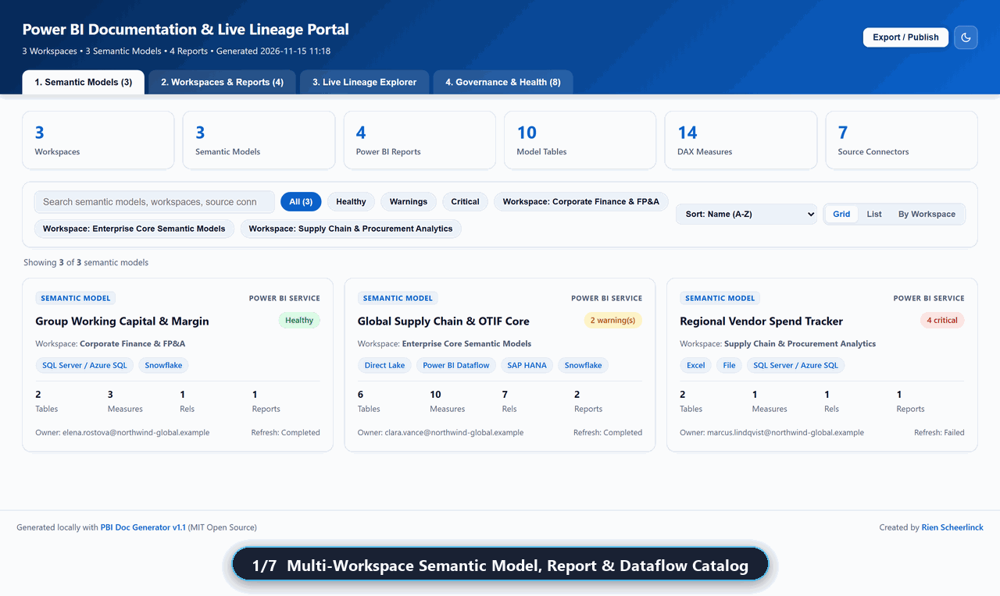

> [!TIP]
> **Direct Windows Download (No Python Required):** [**Click here to download `PBI_Doc_Generator_Windows_Portable.zip`**](https://github.com/djrien-ai/pbi-doc-generator/releases/latest/download/PBI_Doc_Generator_Windows_Portable.zip) -> Right-click **Extract All...** -> double-click **`PBI_Doc_Generator.exe`**. *(Prefer a zero-install preview first? [**Open the Live Browser Demo**](https://djrien-ai.github.io/pbi-doc-generator/).)*

> [!IMPORTANT]
> **Recommended Upgrade for All Users:** `v1.1.0` is a major leap forward in scanning speed, visual-to-SQL lineage, report inspection, PDF printing, and SharePoint publishing. Upgrading from `v1.0.0` is seamless: `v1.1` automatically detects any existing `v1.0` local cache, backs it up safely, and guides you through a 1-click clean start.

## Why Upgrade to `v1.1.0` (At a Glance)

- **10x-15x Faster Parallel Scanner + Live Progress Bar:** Scans large enterprise workspaces (hundreds of models and reports) in minutes with a real-time 5-stage progress bar, live counters, percentage, and ETA.
- **Slide-Over Report & Dataflow X-Ray:** Click any report to inspect **16:9 SVG page wireframes**, bound fields, thin-report local DAX measures, and broken visual bindings without leaving your 4-tab catalog.
- **True End-to-End Lineage (Visual -> SQL & OneLake):** Follows multi-layer **Dataflow Gen1** chains, **Fabric Dataflow Gen2** (`Lakehouse` / `Warehouse` destinations), **Direct Lake** tables, Power Query M steps, and formatted **Native SQL**.
- **Executive A4 PDF Export with Stacked Star Schemas:** Print or save clean portrait PDFs with full-width vector **Star-Schema** diagrams stacked automatically per Fact table, or export Word, Markdown, and CSV Data Dictionaries.
- **1-Click SharePoint Online Publishing:** Publish your interactive portal directly to a SharePoint Document Library URL or export a single-file SharePoint-ready HTML portal.
- **Rock-Solid Sign-In & 10-Tool Local MCP Server:** Instant browser OAuth sign-in with automatic token refresh during long scans, plus 10 read-only local MCP tools for Copilot, Claude Desktop, and Cursor.

---

## Download & Start in 30 Seconds (Windows - No Python Required)

1. **Download:** [**Click here to download `PBI_Doc_Generator_Windows_Portable.zip`**](https://github.com/djrien-ai/pbi-doc-generator/releases/latest/download/PBI_Doc_Generator_Windows_Portable.zip) *(or pick it under **Assets** below; ignore `Source code (zip)` and `Source code (tar.gz)`, which GitHub adds automatically for developers)*.
2. **Extract:** Right-click the downloaded ZIP file and choose **Extract All...**
3. **Launch:** Open the extracted folder and double-click **`PBI_Doc_Generator.exe`**. Your default browser opens automatically at **`http://127.0.0.1:8765`**.
   - *First-run Windows SmartScreen note:* Click **More info** -> **Run anyway** if Windows prompts on first launch.
   - *Workspace role note:* Cloud TMDL, Dataflow, and report layout extraction requires **Contributor** (or higher) in the target workspace. Local `.pbix`, `.pbip`, and `.xlsx` files work 100% offline.

> **Try in Browser First:** [**Explore the Live Interactive `v1.1` Demo Portal**](https://djrien-ai.github.io/pbi-doc-generator/)
>
> **Prefer Python / macOS / Linux?** Run `pip install --upgrade "git+https://github.com/djrien-ai/pbi-doc-generator.git"` and start with `pbi-doc-generator`.
>
> **Saves your team time?** Star the repository, share it with a fellow BI engineer, or [**support ongoing open-source development on Ko-fi**](https://ko-fi.com/rienscheerlinck)!

---
