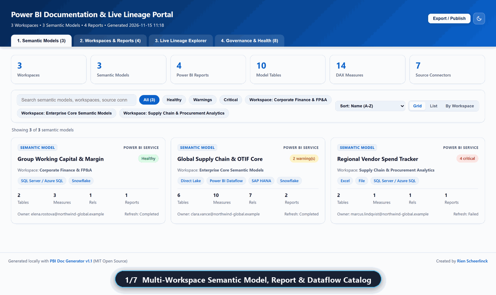

# Power BI Documentation, Report X-Ray & Live Lineage Studio (`pbi-doc-generator` v1.1)

[](https://github.com/djrien-ai/pbi-doc-generator/actions/workflows/ci.yml)
[](https://github.com/djrien-ai/pbi-doc-generator/releases/latest)
[](https://github.com/djrien-ai/pbi-doc-generator/stargazers)
[](https://djrien-ai.github.io/pbi-doc-generator/)
[](LICENSE)
[](https://www.python.org/)
[](SECURITY.md)
[](https://www.linkedin.com/in/rienscheerlinck/)
[](https://ko-fi.com/rienscheerlinck)

[**Live Interactive Demo**](https://djrien-ai.github.io/pbi-doc-generator/) &bull; [**Download Windows `.zip` (No Python)**](https://github.com/djrien-ai/pbi-doc-generator/releases/latest) &bull; [**What's New in `v1.1`**](#why-bi--fabric-teams-upgrade-to-v11) &bull; [**Quick Start**](#quick-start) &bull; [**10-Tool MCP Setup**](#local-ai-assistant-setup-mcp-server---10-read-only-tools) &bull; [**Security**](SECURITY.md) &bull; [**`v1.2` Roadmap**](ROADMAP.md)

> [!TIP]
> **Try `v1.1.0` Latest Stable Release in 30 Seconds**
> - **Interactive Browser Demo (Zero Install):** [**Explore the Live `v1.1` Architecture Portal**](https://djrien-ai.github.io/pbi-doc-generator/)
> - **Windows Portable (No Python required):** [**Download `PBI_Doc_Generator_Windows_Portable.zip`**](https://github.com/djrien-ai/pbi-doc-generator/releases/latest/download/PBI_Doc_Generator_Windows_Portable.zip) -> Extract All -> run `PBI_Doc_Generator.exe` *(or view the [Latest Release page](https://github.com/djrien-ai/pbi-doc-generator/releases/latest))*
> - **Via `pip` (Windows / macOS / Linux):** `pip install --upgrade "git+https://github.com/djrien-ai/pbi-doc-generator.git"` -> run `pbi-doc-generator`
> - **Upgrading from `v1.0.0`?** `v1.1` automatically detects any existing `v1.0` local scan cache and offers a 1-click **Start Clean for v1.1** reset (safely backing up `catalog_state.v1_0.bak.json`) so new Report X-Ray layouts, thin-report DAX, and Dataflow Gen1/Gen2 lineage are captured cleanly.

Turn **Power BI Service / Microsoft Fabric Workspaces** and local **`.pbix` / `.pbip` / `.xlsx`** files into an interactive, searchable architecture portal. Trace any number on a report page from **Visual -> Report-Level DAX -> Semantic Model -> Power Query & Native SQL -> Dataflow Gen1 / Fabric Gen2 -> OneLake / Source Database**, 100% locally and read-only.



---

## Why BI & Fabric Teams Upgrade to `v1.1`

Most Power BI documentation tools stop at a single `.pbix` file, while Power BI's native Workspace Lineage View stops at the container boundary (`Dataflow -> Semantic Model -> Report`) without showing *which* SQL query, Dataflow entity, column, or DAX measure drives *which* visual.

`pbi-doc-generator v1.1` connects the entire estate inside a calm, zero-clutter **4-tab portal**:

1. **Slide-Over Report & Dataflow X-Ray Inspector (No Tab Sprawl)**
   - Click any Power BI report (`PBIR` or legacy `report.json`) to open a slide-over X-Ray drawer without losing your place in the catalog.
   - Renders **16:9 SVG page wireframes** with chart-type schematics, visual group containers, bound measures/columns, report/page/visual filters, slicer selections, **thin-report local DAX measures** (`reportExtensions.json`), and a **1-click Broken Visual Binding Stepper** that highlights visuals pointing to renamed or deleted fields.
2. **Deep Dataflow Gen1, Fabric Dataflow Gen2 & Direct Lake Lineage**
   - Follows multi-layer **Dataflow Gen1** chains (`L1` / `L2+` linked `ReferenceEntity` tables across workspaces) and **Fabric Dataflow Gen2** (`mashup.pq` + OneLake **Lakehouse** and **Warehouse** table destinations), connected directly to **Direct Lake** and Import semantic models.
   - Automatically extracts and formats embedded **Native SQL** (`Value.NativeQuery`, `Sql.Database`, `SapHana`, `Snowflake`, `Odbc.Query`) and translates Power Query M into clickable plain-English transformation steps.
3. **Zero-Dependency Star-Schema Explorer & SQLBI-Formatted DAX Catalog**
   - Native HTML+SVG **Star-Schema Explorer** with **Focused Star** tabs per Fact table, zoom, pan, fullscreen, and click-to-pin relationship highlighting.
   - Pretty-prints single-line DAX into clean **SQLBI-style formatting**, grouped by `Table -> Display Folder -> Dependency Tier`, with instant filter pills (`All`, `Used in Reports`, `Unused`) and end-to-end upstream/downstream trace links.
4. **Scoped Export & 1-Click SharePoint Online Publishing**
   - Click **Export / Publish** from the catalog or from any individual semantic model page and choose your scope (**This Semantic Model** or **Entire Catalog**):
     - **Print / Save as PDF** (clean A4 portrait executive layout with stacked full-width vector **Star-Schema** diagrams)
     - **Standalone HTML** or **Offline Portal `.zip`**
     - **Data Dictionary** (`Word .doc`, `Markdown`, or `CSV`)
     - **SharePoint Online:** either upload directly in 1 click to a SharePoint Document Library URL or download a compressed `srcdoc`-safe single-file HTML portal (`export-site`).
5. **Guided 3-Step Local Web Studio & High-Speed Parallel Scanner (`http://127.0.0.1:8765`)**
   - **Zero Azure Admin Setup:** Sign in with your normal Microsoft work account (`Sign in with Microsoft` OAuth PKCE with instant popup & auto-refresh, corporate `Power BI Web Window` SSO fallback, Azure CLI, or Service Principal).
   - **10x-15x Faster Enterprise Scanning with Live ETA:** Progressive `1. Connect -> 2. Choose Workspaces -> 3. Scan & Build` workflow, 8-worker parallel inventory, 6-worker model TMDL and 8-worker report extraction, progressive `1s` Fabric LRO polling, persistent HTTP/1.1 TLS keep-alive pooling, and a **5-stage live progress bar with percentage and ETA** built for workspaces with hundreds of models and reports.
   - **Safe Catalog Management & Offline Local Mode:** Automatic `v1.0 -> v1.1` upgrade detection with safe backup, `--follow-outside` cross-workspace resolution, explicit `Update Catalog` vs. `Clean Slate` modes, and 100% offline drag-and-drop for `.pbix`, `.pbip` / `.SemanticModel`, and Excel PowerPivot `.xlsx` files.
6. **10-Tool Local Model Context Protocol (MCP) Server for AI Assistants**
   - Connect **VS Code GitHub Copilot**, **Claude Desktop**, **Cursor**, or **Antigravity** to your local catalog (`pbi-doc-generator mcp`) for instant visual-to-SQL impact analysis, DAX explanations, report layout inspection, and governance audits with automatic secret masking.

> **Help shape `v1.2`:** Want Fabric PySpark/SQL Notebook -> Lakehouse lineage ([#18](https://github.com/djrien-ai/pbi-doc-generator/issues/18)), Hidden Filter & RLS-Bypass Risk Audits ([#17](https://github.com/djrien-ai/pbi-doc-generator/issues/17)), Pro-workspace REST fallback ([#16](https://github.com/djrien-ai/pbi-doc-generator/issues/16)), or `DEV` vs. `PROD` model diffs ([#15](https://github.com/djrien-ai/pbi-doc-generator/issues/15))? Check [ROADMAP.md](ROADMAP.md) and vote with a 👍 on the [`v1.2` Milestone Issues](https://github.com/djrien-ai/pbi-doc-generator/milestone/3).

---

## Quick Start

### Option 1: Portable Windows Download (No Python Required)

1. [**Download `PBI_Doc_Generator_Windows_Portable.zip` (Latest Stable Release)**](https://github.com/djrien-ai/pbi-doc-generator/releases/latest/download/PBI_Doc_Generator_Windows_Portable.zip) *(or view the [Latest Release page](https://github.com/djrien-ai/pbi-doc-generator/releases/latest))*.
2. Right-click the downloaded ZIP file and choose **Extract All...**
3. Open the extracted folder and double-click **`PBI_Doc_Generator.exe`** -> your browser opens **`http://127.0.0.1:8765`** automatically.

### Option 2: Install via `pip` (Python 3.10+ on Windows, macOS & Linux)

```bash
pip install --upgrade "git+https://github.com/djrien-ai/pbi-doc-generator.git"
pbi-doc-generator
```

*(Or on Windows with Python installed: `git clone https://github.com/djrien-ai/pbi-doc-generator.git` and double-click **`Start_Studio.cmd`**.)*

> [!NOTE]
> **Power BI Service Workspace Role Prerequisite (`Contributor` or higher)**
> Extracting semantic model TMDL, Dataflow definitions, and cloud report layouts via Microsoft's read-only `getDefinition` API requires at least **Contributor** (**Contributor**, **Member**, or **Admin**) in the target workspace. `Viewer`-only workspaces still return workspace and report inventory. Local `.pbix`, `.pbip`, and `.xlsx` files require no Power BI Service permissions.

---

## Command-Line Usage (CLI & CI/CD)

```bash
# Launch the interactive Web Studio on http://127.0.0.1:8765 (default)
pbi-doc-generator

# Scan specific workspaces (add --follow-outside to resolve upstream models/dataflows in other workspaces)
pbi-doc-generator scan --workspace "Supply Chain" --follow-outside

# Generate an anonymized portal safe for external sharing (redacts owner/user names)
pbi-doc-generator portal --anonymous

# Package the entire portal into a single SharePoint-safe HTML file
pbi-doc-generator export-site -o ./PBI_Catalog_SharePoint.html

# Export a deep end-to-end SQL -> Power Query -> DAX -> Visual lineage spec for one measure
pbi-doc-generator measure-doc "OTIF %" --model "Global Supply Chain & OTIF Core" -o ./OTIF_Lineage.md

# Import a local .pbip, .SemanticModel, .pbix, or .xlsx into the catalog
pbi-doc-generator import-local ./SalesModel.pbip

# Start the local stdio MCP server (10 read-only tools) for AI assistants
pbi-doc-generator mcp
```

---

## Local AI Assistant Setup (MCP Server - 10 Read-Only Tools)

Connect **VS Code GitHub Copilot** (`.vscode/mcp.json`), **Claude Desktop** (`claude_desktop_config.json`), or **Cursor** (`~/.cursor/mcp.json`) to your scanned catalog so AI agents can trace lineage and audit models locally without cloud data exposure:

```json
{
  "mcpServers": {
    "pbi-doc-generator": {
      "command": "pbi-doc-generator",
      "args": ["mcp"]
    }
  }
}
```

*(Using the Windows Portable download instead of `pip`? Point `"command"` to `"C:\\path\\to\\PBI_Doc_Generator\\PBI_Doc_Generator.exe"` with `"args": ["mcp"]`.)*

**Included read-only MCP tools (with automatic secret masking):**
- **Catalog & Model Blueprint:** `pbi_catalog_summary`, `pbi_list_models`, `pbi_inspect_model`
- **Code & Lineage Search:** `pbi_search_dax_and_m`, `pbi_measure_lineage`, `pbi_trace_measure_end_to_end`
- **Report Visuals & Blast Radius:** `pbi_report_layout`, `pbi_source_impact`
- **Governance & Publishing:** `pbi_health_audit`, `pbi_generate_portal`

---

## Security & Privacy by Design

- **100% Local Execution:** Metadata, TMDL/PBIR definitions, and generated HTML stay on your machine (`127.0.0.1`). Zero telemetry or external CDN calls.
- **Hardcoded Read-Only Power BI API Guard:** `PowerBiReadOnlyClient` blocks `DELETE`, `PATCH`, `PUT`, and mutating `POST` calls at the transport layer, allowing only `GET` metadata endpoints and read-only `getDefinition` calls.
- **In-Memory Tokens Only:** OAuth access tokens live strictly in Python RAM for the active session and are never written to disk.
- **Automatic Secret & Storage Redaction:** Connection passwords, SAS signatures, API keys, bearer tokens, and internal Dataflow storage URLs are automatically masked or stripped. See [SECURITY.md](SECURITY.md) for details.

---

## Enterprise Integrations & Architecture Audits

The core of `pbi-doc-generator` is and remains 100% free and open-source under the MIT License. Organizations looking for custom enterprise integrations (automated CI/CD lineage publishing to SharePoint, Confluence, or Microsoft Purview, historical semantic-model drift monitoring, or white-label governance portals) or an independent **Power BI Estate & Semantic Model Architecture Audit** can connect with **Rien Scheerlinck** ([LinkedIn](https://www.linkedin.com/in/rienscheerlinck/) | **Bohan VOF**):

[](https://www.linkedin.com/in/rienscheerlinck/)
[](mailto:dj.rien@gmail.com?subject=Power%20BI%20Enterprise%20%26%20Architecture%20Inquiry)

---

## Community & Support

Created and maintained by [Rien Scheerlinck](https://www.linkedin.com/in/rienscheerlinck/) (`@djrien-ai`), with thanks to community contributors `@andreasfelder` (PR #19 contributions toward #13/#14 Dataflow Gen1, thin-report parsing & single-file SharePoint export), `@jakubpokusa` (PR #10 relationship viewer), `@okiyuki99` (PR #11 Xpress9 `pbixray` support), and `@nblankes` (Issue #12 TMDL table doc-comment report).

If `pbi-doc-generator` saves your BI team hours of manual documentation or impact analysis, consider starring the repository or [**supporting ongoing open-source development on Ko-fi**](https://ko-fi.com/rienscheerlinck).

## License

MIT License - Copyright (c) 2024-2026 Rien Scheerlinck. See [LICENSE](LICENSE) for full text.
